<h1 align="center">drinaluza 🚀</h1>

  <strong>From Sea to Shore, Managed.</strong> 
  The public distribution channel for the <strong>drinaluza</strong> Android app — a marketplace and toolkit for fishing crews, seafood sellers, and coastal communities.

  
  
  
  

  <a href="https://drinaluza.com/">Website</a> ·
  <a href="https://github.com/ahmed-derbala/drinaluza-releases/releases/latest">Latest release</a> ·
  <a href="CHANGELOG.md">Changelog</a> ·
  <a href="https://github.com/ahmed-derbala/drinaluza-releases/issues">Report an issue</a>

---

## 📥 Download & install

1. Open the [latest release](https://github.com/ahmed-derbala/drinaluza-releases/releases/latest).
2. Download the `drinaluza-*.apk` file from the **Assets** section.
3. On your Android device, allow installs from your browser or file manager when prompted.
4. Open the downloaded APK and install it.

The app can also check for and download new versions from its **Updates** screen.

> **APK only for now.** Prefer the web version? Head to [drinaluza.com](https://drinaluza.com/).

---

## ✨ Features

**Marketplace**

- Create an account in seconds.
- Buy and sell seafood products and maritime equipment.
- Browse listings with photos, prices in Tunisian dinar (TND), and direct seller contact.

**Sea & coast**

- Rent jet skis, boat trips, and coastal houses.
- Weather tailored for swimming and fishing.
- Manage fishing crews and track boats.
- Talk with boats and crews with or without an internet connection.

**For businesses**

- Manage your products from a business dashboard.
- Share your business page so customers can call, message, or find you.
- Use the app in English, Tunisian Latin or Tunisian Arabic.
- Keep lists and photos available offline.

---

## 📱 Screenshots

<!-- SCREENSHOTS_START -->

  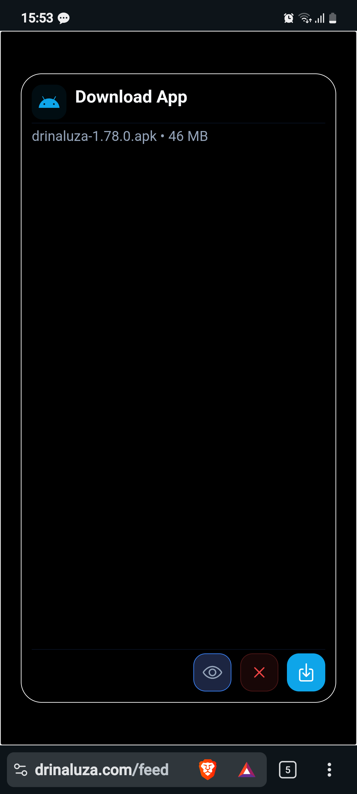
  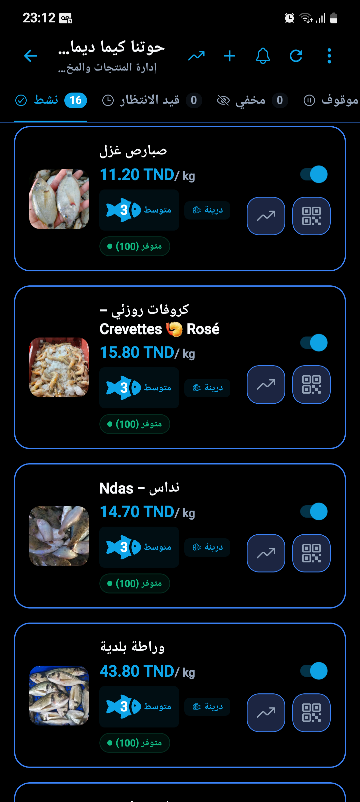
  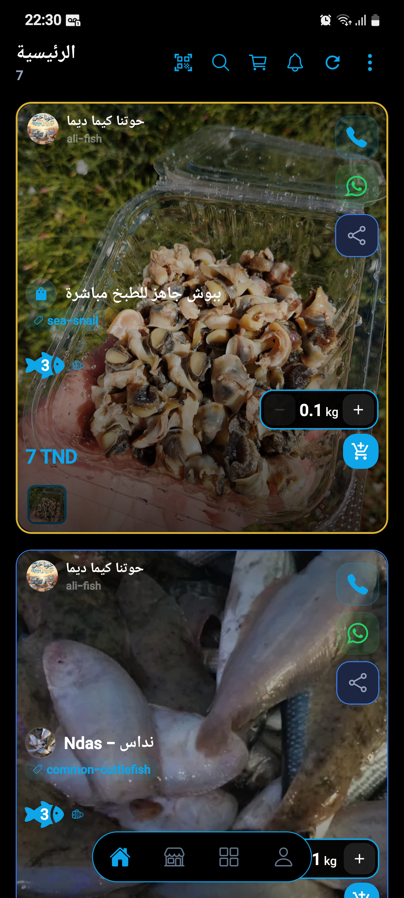
  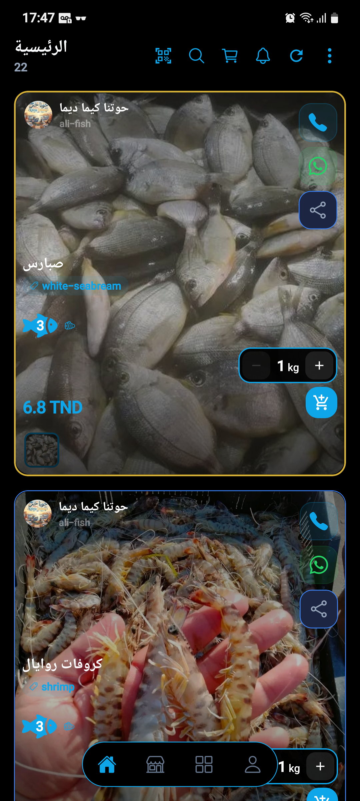
  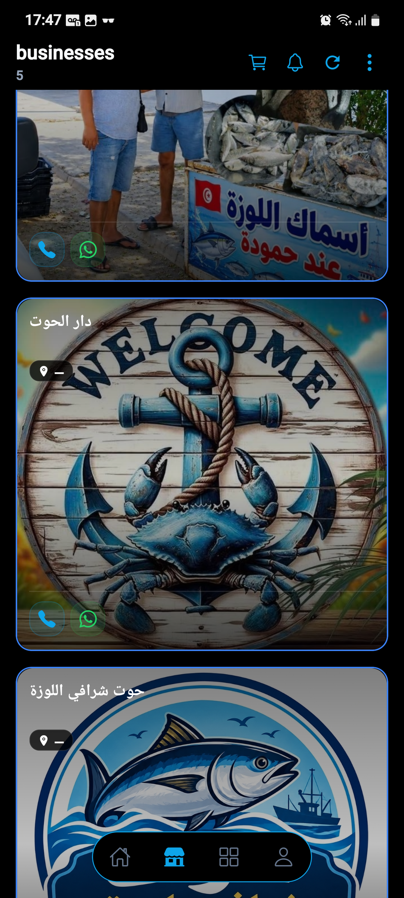
  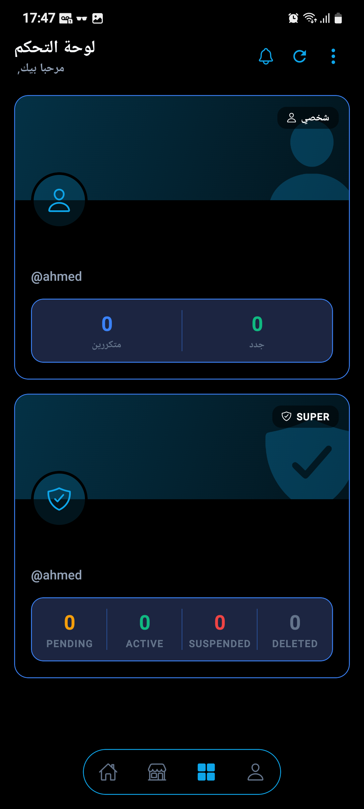
  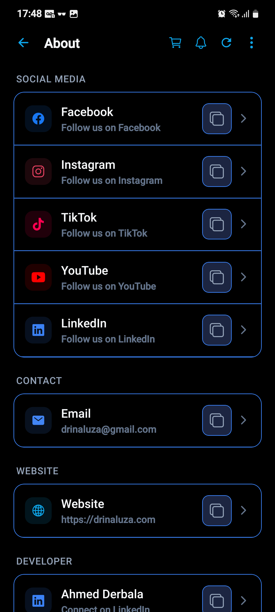
  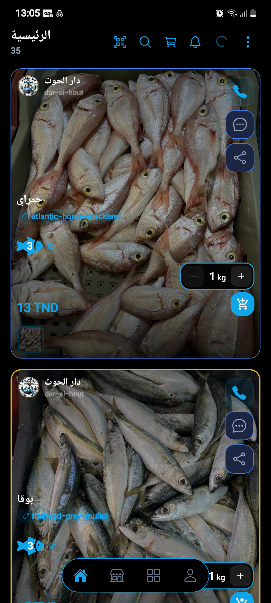
  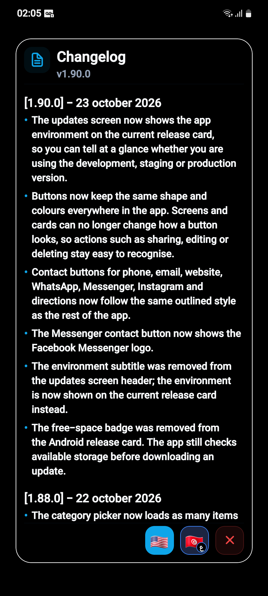
  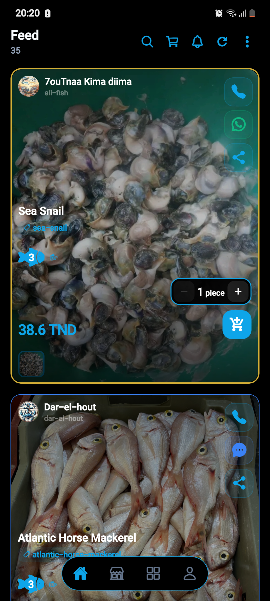
  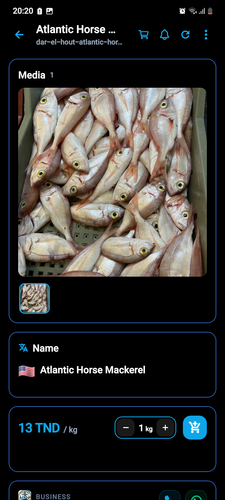
  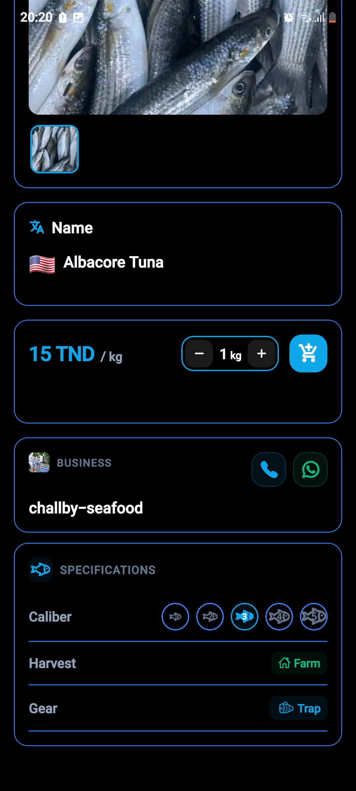
  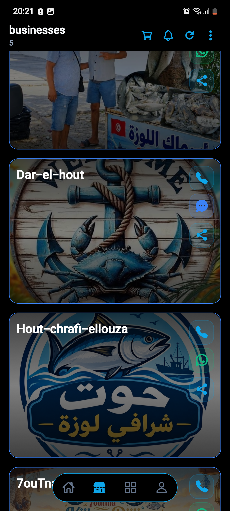
  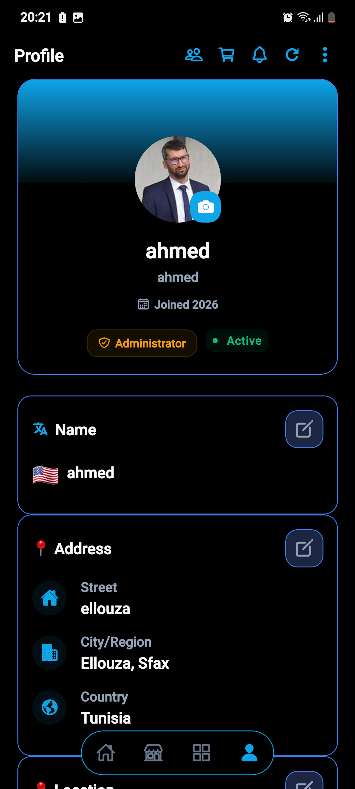
  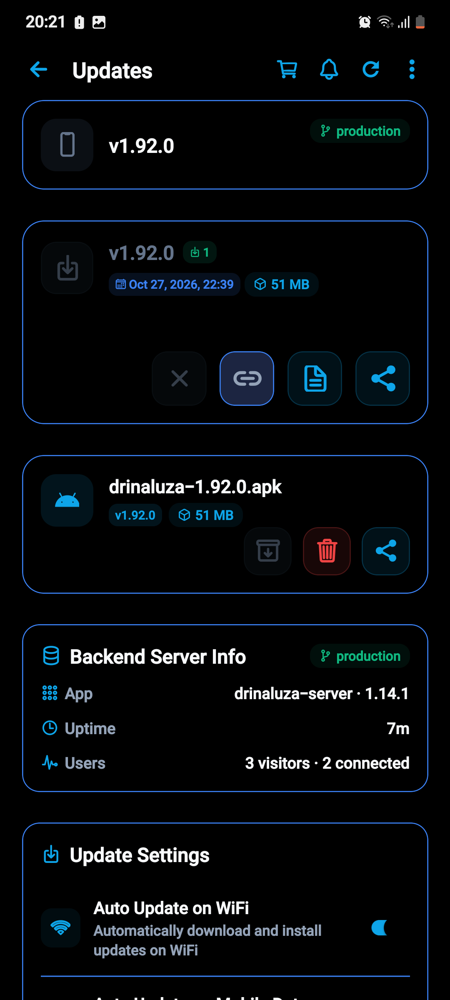
  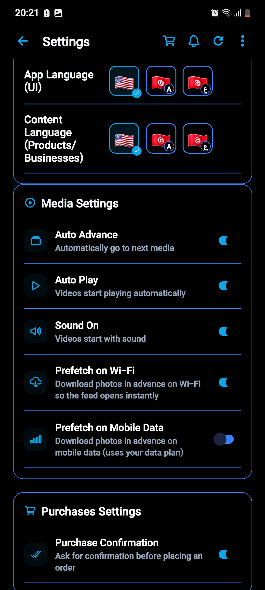
  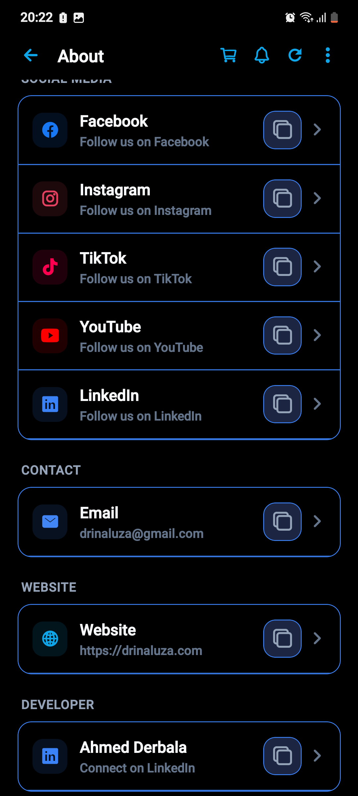

<!-- SCREENSHOTS_END -->

---

## 🛠 Tech stack

| Layer | Stack |
| --- | --- |
| Frontend | Expo, TypeScript |
| Backend | Express.js, JavaScript |
| Database | MongoDB, Mongoose |
| Tooling | Debian (LMDE), VS Code, VSCodium, Postman, Devin, Antigravity, OpenCode |

Dependencies track the latest LTS releases.

---

## 📦 Releases & changelog

Every version is published on the [releases page](https://github.com/ahmed-derbala/drinaluza-releases/releases) with an installable APK. See [CHANGELOG.md](CHANGELOG.md) for the full history of changes.

---

## 🌐 Social media

Follow **drinaluza** for product updates, new features, and marketplace news.

  
  
  
  

---

## 👨‍💻 Author

**Ahmed Derbala**

🔗 [LinkedIn](https://www.linkedin.com/in/ahmed-derbala/) · [GitHub](https://github.com/ahmed-derbala)

---

© 2026 drinaluza · From Sea to Shore, Managed.

